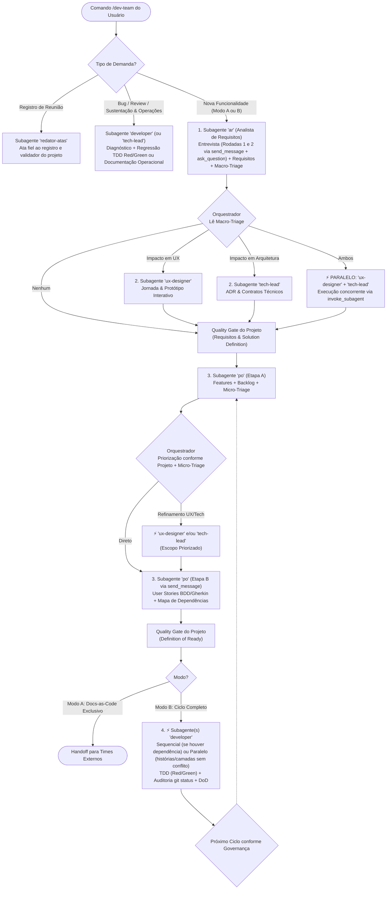

# dev-team 2.2.0: Time Multi-Agente de Engenharia Ágil & Docs-as-Code

Bem-vindo ao **dev-team 2.2.0**, um ecossistema multi-agente de engenharia de software para o **Google Antigravity 2.0** e CLI (`agy`), projetado como um motor **100% agnóstico** e subordinado à governança **Docs-as-Code** de cada repositório.

Na arquitetura **v2.2.0**, o `dev-team` elimina toda duplicação e qualquer acoplamento a metodologias fixas ao estruturar:
- **1 Única Skill de Entrada (`skills/dev-team/SKILL.md` $\rightarrow$ `/dev-team`)**: O **Orquestrador** da equipe, que recebe qualquer demanda do usuário (nova feature em Modo A ou B, diagnóstico de bug ou redação de ata de reunião), valida mecanicamente os Quality Gates e ritos de transição definidos no `AGENTS.md` local e coordena os especialistas com paralelismo livre de conflitos.
- **6 Agentes Especialistas Autocontidos (`agents/*.md`)**: Cada subagente possui **toda a sua inteligência e procedimento embutidos nativamente no próprio System Prompt** (Fonte Única de Verdade), rodando em **janela de contexto própria e isolada**, no tier **`model: flash`** (com escalação controlada para `pro`), **`inheritMcp: false` por padrão**, **ferramentas restritas ao mínimo necessário** e **trava anti-delegação espontânea (`[Só via /dev-team]`)**.



---

## 0. Regra Mestre de Override (Inversão de Controle Pura) e Nota de Transparência

O `dev-team` opera como um **motor agnóstico orientado a capacidades**:

1. **Subordinação Integral ao Manifesto do Projeto (`AGENTS.md` / `AI_GOVERNANCE.md`)**: A primeira ação mandatória do Orquestrador e de qualquer subagente é ler o manifesto de governança na raiz do repositório alvo e seguir recursivamente quaisquer diretórios de padrões, camadas de customização/overlay local ou arquivos de exceções que o manifesto referencie, respeitando a precedência definida pelo projeto. As diretrizes locais sobre quais artefatos produzir, templates, estrutura de seções, limites de lote/WIP, status de ciclo de vida, stack tecnológica e Quality Gates (DoR/DoD, comandos de PR e validações mecânicas de Git) sobrepõem sumariamente quaisquer definições padrão do time.
2. **Paralelismo Livre de Conflitos**: O `dev-team` não impõe limitações artificiais ao paralelismo. Sempre que duas tarefas ou histórias não possuírem dependência sequencial na implementação nem risco de conflito nos mesmos arquivos, o Orquestrador pode despachá-las em paralelo com **Propriedade Exclusiva de Arquivos** e proteção prévia de manifestos/lockfiles compartilhados.
3. **Proibição Absoluta de Arquivos Proprietários**: O `dev-team` é terminantemente proibido de criar arquivos de configuração internos (como `.devteamrc` ou `.devteam-config.yml`) no projeto consumidor.
4. **Isolamento entre Links do Chat (`file:///`) e Links do Repositório**: Dentro de arquivos gravados e versionados no repositório, os agentes utilizam caminhos relativos (ou o padrão determinado pelo projeto), reservando o esquema `file:///` exclusivamente para mensagens exibidas no chat da IDE.
5. **Passagem de Bastão via Docs-as-Code**: Como cada subagente roda em uma janela de contexto limpa e isolada, o handoff entre papéis ocorre através dos artefatos versionados no repositório.

> [!IMPORTANT]
> **Nota de Transparência Arquitetural (Configuração da Plataforma vs. Calibragem por Prompt)**
> No Antigravity 2.0, o `dev-team` separa de forma explícita o que é imposto pelo runtime da plataforma do que é governado por instruções de prompt:
> - **Aplicado pela Plataforma (Frontmatter YAML dos Agentes & Runtime)**:
>   - **Isolamento de Contexto**: Cada subagente (`invoke_subagent`) inicia com janela de contexto limpa e própria.
>   - **Tier de Modelo (`model: flash` / `Model: "pro"`)**: Aplicado nativamente pelo runtime do subagente e sobrescritível pelo Orquestrador via `invoke_subagent(..., Model: "pro")`.
>   - **Escopo de Ferramentas (`tools`), `inheritMcp: false` e `commandExecutionPolicy: sandbox`**: Aplicados pelo motor Cortex na inicialização do subagente.
> - **Aplicado por Calibragem Comportamental de Prompt e Auditoria do Orquestrador**:
>   - **Esforço de Raciocínio (*Low / Medium / High-Effort*)**: A plataforma Antigravity 2.0 não possui campo YAML de `thinking_effort` individual por subagente (o *thinking budget* da API é herdado da sessão pai). A diferenciação de esforço entre os papéis é realizada por calibragem comportamental no prompt de cada agente (respostas diretas no AR/Redator vs. checklists analíticos e ciclo TDD físico no Tech Lead/Developer).
>   - **Propriedade Exclusiva de Arquivos (*Exclusive File Ownership*) e Disjuntor de 2 Falhas**: São regras de prompt auditadas pelo Orquestrador ao final de cada turno (via `git status --short` e verificação do output literal de testes).

---

## 1. Os 6 Agentes Especialistas Autocontidos (`agents/*.md`)

Todos os 6 agentes possuem `mainAgent: false`, `subagent: true`, `inheritMcp: false` e prefixo `[Só via /dev-team]` na descrição para evitar delegação espontânea fora da esteira:

| Agente (`agents/` — Fonte Única) | Capacidades Embutidas no Agente | Tier Nativo (`model`) | Ferramentas Habilitadas (`tools` + nativas de leitura/comunicação) | Calibragem Comportamental & Escalação (`pro`) |
| :--- | :--- | :--- | :--- | :--- |
| **`ar`** (`agents/ar.md`) | Engenharia de Requisitos, Entrevista em 2 Rodadas e Macro-Triage | `flash` | `write_file`, `edit_file`, `search_web`, `run_command` | **Low-Effort / Direto**: Elicitação em 2 rodadas (repassadas *verbatim* pelo Orquestrador com widget clicável `ask_question` e respondidas via `send_message`) + Macro-Triage. Escala para `pro` sob aprovação humana em domínios regulatórios/matemáticos densos. |
| **`ux-designer`** (`agents/ux-designer.md`) | Jornada do Usuário e Prototipação Funcional Interativa (4 estados) | `flash` | `write_file`, `edit_file`, `search_web`, `run_command` | **Medium-Effort / 4 Estados**: Jornada do Usuário + Protótipos funcionais cobrindo os estados Vazio, Loading, Erro e Sucesso sobre o escopo priorizado. Escala para `pro` em interfaces com múltiplos estados concorrentes. |
| **`tech-lead`** (`agents/tech-lead.md`) | Decisões Arquiteturais (ADRs), Contratos Técnicos (APIs/Schemas), Modelagem de Dados/Taxonomia/Ontologia e Operabilidade | `flash` | `write_file`, `edit_file`, `run_command`, `search_web` | **High-Effort / Matriz de Trade-offs**: ADRs comparando alternativas, Contratos Técnicos e Modelagem de Dados (semântica, ontológica e física) sobre o escopo priorizado. Escala para `pro` sob aprovação humana em sistemas distribuídos críticos/concorrência severa. |
| **`po`** (`agents/po.md`) | Decomposição em Features, Gestão de Backlog, Micro-Triage e User Stories BDD | `flash` | `write_file`, `edit_file`, `run_command` | **Medium-Effort / Cadência com STOPS**: Etapa A (Features + Backlog + Micro-Triage) $\rightarrow$ STOP $\rightarrow$ Etapa B via `send_message` (User Stories BDD/Gherkin + Mapa de Dependências para paralelismo sem conflito). |
| **`developer`** (`agents/developer.md`) | Implementação TDD Red/Green, Diagnóstico de Bugs, Sustentação/Operações e DoD | `flash` | `write_file`, `edit_file`, `run_command`, `search_web` | **High-Effort / TDD Red-Green + Sustentação + DoD**: Implementação, testes automatizados, diagnóstico de bugs e sustentação/operações. Suporta paralelismo de histórias/camadas sem conflito com proteção de lockfiles. Disjuntor de escalação para `pro` após 2 rodadas de falha de testes no Flash. |
| **`redator-atas`** (`agents/redator-atas.md`) | Redação de Atas de Reunião fiéis ao registro bruto e ao template local | `flash` | `write_file`, `edit_file`, `run_command` | **Low-Effort / Fidelidade Determinística**: Converte registros brutos de reunião em atas fiéis ao que foi dito, seguindo 100% o template e validador do projeto. |

---

## 2. Como Usar no Google Antigravity

Você aciona **tudo** por meio de um único comando de entrada (`/dev-team`), e o Orquestrador despacha o subagente especialista ideal:

* **Iniciar Nova Funcionalidade (Ciclo Completo ou Docs-as-Code)**:
  > `/dev-team Vamos iniciar a funcionalidade de autenticação social.`
* **Diagnosticar/Corrigir um Bug ou Atuar em Sustentação/Operações**:
  > `/dev-team Diagnostique e corrija em TDD o erro 500 no endpoint de pagamentos.`
  > `/dev-team Documente o procedimento operacional e a solução de contorno para o incidente de fila.`
* **Gerar Ata de Reunião a partir de Transcrição/Notas**:
  > `/dev-team Gere a ata padronizada a partir do registro da reunião em docs/raw/reuniao.txt.`

---

## 3. Estrutura Canônica do Plugin (`dev-team 2.2.0`)

```text
dev-team/
├── agents/                                   # Especialistas Autocontidos (Fonte Única de Verdade + Contexto Isolado + Tier Flash)
│   ├── ar.md                                 # Analista de Requisitos (Elicitação em 2 rodadas + Macro-Triage)
│   ├── ux-designer.md                        # UX / Product Designer (Jornada do Usuário + Protótipos nos 4 estados)
│   ├── tech-lead.md                          # Tech Lead / Architect (ADRs + Contratos de API e Schemas de Dados)
│   ├── po.md                                 # Product Owner (Features, Backlog, Micro-Triage, US BDD e Mapa de Dependências)
│   ├── developer.md                          # Developer (TDD Red/Green, Diagnóstico de Bugs, Paralelismo sem Conflito e DoD)
│   └── redator-atas.md                       # Redator de Atas sob demanda (Fidelidade estrita ao registro bruto)
├── skills/
│   └── dev-team/                             # Única Skill de Entrada (/dev-team): Orquestrador, Gates, FinOps e Paralelismo
│       └── SKILL.md
├── plugin.json                               # Manifesto oficial do plugin Antigravity 2.0 (v2.2.0)
└── README.md                                 # Documentação arquitetural e nota de transparência
```
