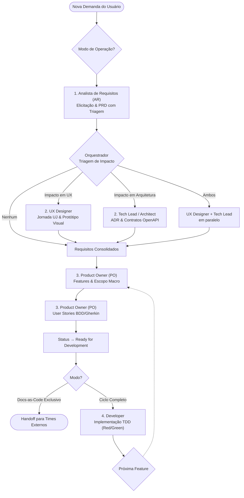

# DevTeam: Time Multi-Agente de Engenharia Ágil & Docs-as-Code

Bem-vindo ao **DevTeam**, um ecossistema multi-agente de desenvolvimento de software de alta performance para o Google Antigravity e VS Code, orientado à governança corporativa **Docs-as-Code**.

O DevTeam estrutura cinco especialidades independentes que operam em pipeline contínuo e colaborativo, cobrindo todo o ciclo de vida do software: **Analista de Requisitos (AR)**, **UX / Product Designer**, **Tech Lead / Architect**, **Product Owner (PO)** e **Developer**.



---

## 0. Regra Mestre de Override (Inversão de Controle & DEC-034)

O DevTeam opera com **inteligência subordinada**:

1. **Subordinação ao Manifesto do Projeto (`AGENTS.md`)**: A primeira ação mandatória de qualquer agente é ler o `AGENTS.md` (ou `AI_GOVERNANCE.md`) na raiz do repositório alvo. As diretrizes locais, convenções de branches, templates e Quality Gates organizacionais sobrepõem sumariamente quaisquer definições internas do time.
2. **Proibição Absoluta de Arquivos Proprietários (DEC-034)**: O DevTeam é terminantemente proibido de criar arquivos de configuração internos (como `.devteamrc` ou `.devteam-config.yml`) no projeto consumidor. O projeto alvo permanece 100% limpo de metadados da equipe.
3. **Vendoring Estático**: Os padrões de engenharia e governança residem no cache local do projeto consumidor (ex: `.ai-standards/`), sendo atualizados sob demanda pelo próprio projeto, sem injeções dinâmicas a cada invocação.

---

## 1. As Cinco Especialidades da Equipe

O DevTeam fornece os papéis e comportamentos especializados, enquanto **o nome, formato e diretório de cada artefato são 100% governados pelo manifesto `AGENTS.md` do projeto consumidor** (Inversão de Controle). 

Abaixo estão as responsabilidades de cada papel e, a título de referência, a convenção semântica recomendada pelo framework corporativo (DEC-024) quando adotada pelo projeto:

### 1.1. Analista de Requisitos (AR)
* **Atribuição**: Elicitação profunda através de questionamento investigativo exaustivo, delimitação de escopo, regras de negócio e preenchimento da Triagem de Impacto.
* **Modelo LLM**: Tier nativo `flash` (Gemini 3.8 Flash). **Esforço de Raciocínio**: `low` (altíssima velocidade, ampla janela de contexto e consumo mínimo de tokens de reflexão).
* **Artefato Típico (Ref. DEC-024)**: `PRD-<numero>-<slug>.md` (conforme convenção indicada no `AGENTS.md` local).

### 1.2. UX / Product Designer
* **Atribuição**: Mapeamento de fluxos de interação, estados de interface, microinterações e protótipos funcionais interativos (Living Specs em React/Tailwind ou HTML).
* **Modelo LLM**: Tier nativo `flash` (Gemini 3.8 Flash). **Esforço de Raciocínio**: `medium`. Escalação para `pro` (Gemini 4 Argon) sob recomendação e autorização humana para interfaces com múltiplos estados concorrentes complexos.
* **Artefatos Típicos (Ref. DEC-024)**:
  - Jornada do Usuário: `UJ-<numero>-<slug>.md`
  - Protótipos: código interativo no diretório designado pelo projeto consumidor.

### 1.3. Tech Lead / Architect
* **Atribuição**: Avaliação de viabilidade técnica, modelagem de dados, especificações formais de API (OpenAPI/Swagger) e registro formal de trade-offs arquiteturais.
* **Modelo LLM**: Tier nativo `flash` (Gemini 3.8 Flash). **Esforço de Raciocínio**: `high` (reflexão aprofundada para evitar débitos técnicos). Escalação para `pro` (Gemini 4 Argon) sob recomendação e autorização humana para arquiteturas distribuídas de missão crítica e concorrência severa.
* **Artefato Típico (Ref. DEC-024)**: `ADR-<numero>-<slug>.md` (Decisão Arquitetural) e esquemas de API.

### 1.4. Product Owner (PO)
* **Atribuição**: Decomposição em Features de negócio e desdobramento em Histórias de Usuário atômicas com critérios de aceite em BDD/Gherkin, contratos e restrições.
* **Modelo LLM**: Tier nativo `flash` (Gemini 3.8 Flash). **Esforço de Raciocínio**: `medium` (precisão estruturada e formatação consistente sem queima de cota).
* **Artefatos Típicos (Ref. DEC-024)**:
  - Feature: `FEAT-<numero>-<slug>.md`
  - História de Usuário: `US-<numero>-<slug>.md`

### 1.5. Developer
* **Atribuição**: Implementação do código de produção e testes automatizados com ciclo TDD rigoroso (Red/Green), respeitando as USs, protótipos e contratos aprovados. Suporta paralelismo (ex: Frontend e Backend simultâneos).
* **Modelo LLM**: Tier nativo `flash` (Gemini 3.8 Flash). **Esforço de Raciocínio**: `high` (simulação mental de testes e cobertura completa). Escalação para `pro` (Gemini 4 Argon) sob recomendação e autorização humana para refatoração de código com acoplamento massivo ou após 2 tentativas de falha de teste no Flash.
* **Trilha de Sustentação de Bugs (Bug Track)**: `BUG-<numero>-<slug>.md` com roteiro de reprodução e teste de regressão.

---

## 2. Modos de Operação do Time

O DevTeam adapta sua atuação conforme o escopo acordado no projeto:

* **Modo A: Docs-as-Code Exclusivo**: Atuação estritamente analítica e arquitetural (Requisitos, UX, Arquitetura e Histórias de Usuário). O time **não cria nem edita código de produção**, entregando especificações blindadas para times ou desenvolvedores externos.
* **Modo B: Ciclo Completo (End-to-End)**: Concepção completa via Docs-as-Code seguida de implementação em código de produção e testes unitários/integração verdes pelo Developer.

---

## 3. Como Usar no Google Antigravity

Você pode interagir diretamente com o DevTeam no chat do Antigravity via linguagem natural:

* **Ciclo Completo de Feature**:
  > *"Vamos iniciar a funcionalidade de autenticação social com o DevTeam."*

* **Fase de Requisitos**:
  > *"Atue como o Analista de Requisitos e conduza a entrevista investigativa para o recurso X."*

* **Fase de Experiência e Prototipação**:
  > *"Atue como o UX Designer e crie a jornada UJ e o protótipo da tela de checkout."*

* **Fase de Arquitetura e Decisão**:
  > *"Atue como o Tech Lead e avalie a migração de cache com uma ADR comparando Redis e Memcached."*

* **Fase de Refinamento de Histórias**:
  > *"Atue como o Product Owner e decomponha a Feature X em User Stories BDD."*

* **Fase de Implementação de Código**:
  > *"Atue como o Developer e implemente a US-001 com cobertura total de testes em TDD."*

* **Diagnóstico e Correção de Bug**:
  > *"Atue como o time para diagnosticar o erro 500 no endpoint de pagamentos e gerar o BUG-001."*

---

## 4. Estrutura de Diretórios do DevTeam

Estrutura canônica do plugin:

```text
C:\Dev\Projetos\Particular\dev-team\
├── config/
│   └── model_router.json                     # Matriz Flash-First, esforço de raciocínio (thinking effort) e gate de cota
├── rules/
│   └── GEMINI.md                             # Governança mestre, 5 papéis e protocolo de orquestração
├── skills/
│   ├── analise-requisitos/                   # Habilidade do AR (PRD com Triagem de Impacto)
│   ├── prototipacao-ui/                      # Habilidade do UX Designer (Protótipos React e Jornada UJ)
│   ├── decisao-arquitetural/                 # Habilidade do Tech Lead (ADRs e Trade-offs)
│   ├── design-api-contratos/                 # Habilidade do Tech Lead (Contratos OpenAPI e Schemas)
│   ├── refinamento-po/                       # Habilidade do PO (Features e US com BDD/Gherkin)
│   ├── desenvolvimento/                      # Habilidade do Developer (TDD Red/Green e Paralelismo)
│   └── diagnostico-bug/                      # Habilidade de triagem e especificação de bugs
├── hooks.json                                # Configuração de hooks do Antigravity
├── plugin.json                               # Manifesto do plugin Antigravity
└── README.md                                 # Este manual
```
