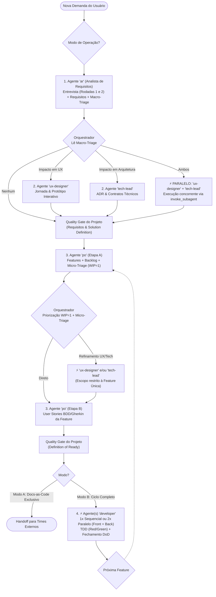

# dev-team 2.0: Time Multi-Agente de Engenharia Ágil & Docs-as-Code

Bem-vindo ao **dev-team 2.0**, um ecossistema multi-agente de engenharia de software para o **Google Antigravity 2.0** e CLI (`agy`), desenhado em **Arquitetura Híbrida (`skills/` + `agents/`)** e subordinado à governança corporativa **Docs-as-Code**.

Diferente de pacotes baseados apenas em skills (que acumulam todas as fases no mesmo contexto da conversa principal), o **dev-team 2.0** combina:
- **6 Agentes Especialistas Nativos (`agents/*.md`)**: Subagentes reais com **contexto próprio e isolado**, **tier de modelo pré-configurado (`flash` com escalação controlada para `pro`)**, **permissões/ferramentas restritas ao mínimo necessário** (`inheritMcp: false` nos papéis documentais e `sandbox` na execução) e **calibragem cognitiva de esforço no System Prompt**.
- **9 Skills Modulares (`skills/*/SKILL.md`)**: Mantêm todos os atalhos de barra (`/dev-team`, `/analise-requisitos`, `/prototipacao-ui`, `/decisao-arquitetural`, `/design-api-contratos`, `/refinamento-po`, `/desenvolvimento`, `/diagnostico-bug`, `/redacao-atas`) para invocação direta ou orquestrada.



---

## 0. Regra Mestre de Override (Inversão de Controle)

O `dev-team` opera com **inteligência subordinada e orientada a capacidades**:

1. **Subordinação Integral ao Manifesto do Projeto (`AGENTS.md` / `AI_GOVERNANCE.md`)**: A primeira ação mandatória do Orquestrador e de qualquer subagente é ler o manifesto de governança na raiz do repositório alvo. As diretrizes locais sobre quais artefatos produzir, templates, estrutura de seções, status de ciclo de vida, stack tecnológica, convenções de versionamento e Quality Gates (DoR/DoD) sobrepõem sumariamente quaisquer definições padrão do time.
2. **Proibição Absoluta de Arquivos Proprietários**: O `dev-team` é terminantemente proibido de criar arquivos de configuração internos (como `.devteamrc` ou `.devteam-config.yml`) no projeto consumidor. O projeto alvo permanece 100% limpo de metadados da equipe.
3. **Passagem de Bastão via Docs-as-Code**: Como cada subagente roda em uma janela de contexto limpa e isolada, o handoff entre papéis ocorre através dos artefatos versionados no repositório (PRD, Jornada, Protótipo, ADR, Contratos, Features e User Stories), mantendo o consumo de tokens estritamente enxuto.

---

## 1. Os 6 Agentes Especialistas (`agents/*.md`) e Calibragem Cognitiva

| Agente (`agents/`) | Skills Associadas (`skills/`) | Tier Nativo (`model`) | Escopo de Ferramentas & MCP | Calibragem de Esforço & Escalação (`pro`) |
| :--- | :--- | :--- | :--- | :--- |
| **`ar`** (`agents/ar.md`) | `/analise-requisitos` | `flash` | Leitura/escrita documental + `ask_question` (`inheritMcp: false`). Pode atuar como `mainAgent` ou `subagent`. | **Low-Effort / Direto**: Elicitação investigativa em 2 rodadas (mantendo a mesma sessão via `send_message`) + Macro-Triage. Escala para `pro` sob aprovação humana em domínios regulatórios/matemáticos densos. |
| **`ux-designer`** (`agents/ux-designer.md`) | `/prototipacao-ui` | `flash` | Leitura/escrita + geração de ativos visuais (`inheritMcp: false`). | **Medium-Effort / 4 Estados**: Jornada do Usuário + Protótipos funcionais cobrindo os estados Vazio, Loading, Erro e Sucesso. Escala para `pro` em interfaces com múltiplos estados concorrentes. |
| **`tech-lead`** (`agents/tech-lead.md`) | `/decisao-arquitetural`<br/>`/design-api-contratos` | `flash` | Leitura/escrita + `run_command` em sandbox + MCPs ativos (`inheritMcp: true`). | **High-Effort / Matriz de Trade-offs**: ADRs comparando alternativas e Contratos Técnicos (OpenAPI, GraphQL, DDL SQL). Escala para `pro` sob aprovação humana em sistemas distribuídos críticos/concorrência severa. |
| **`po`** (`agents/po.md`) | `/refinamento-po` | `flash` | Leitura/escrita documental (`inheritMcp: false`). | **Medium-Effort / Cadência com STOPS**: Etapa A (Features + Backlog + Micro-Triage) -> STOP -> Etapa B (User Stories BDD/Gherkin atômicas `WIP=1`). |
| **`developer`** (`agents/developer.md`) | `/desenvolvimento`<br/>`/diagnostico-bug` | `flash` | Engenharia completa + `run_command` em `sandbox` + `manage_task` (`inheritMcp: true`). | **High-Effort / TDD Red-Green + DoD**: Implementação, testes automatizados e diagnóstico de bugs. Suporta execução paralela (Front + Back) com *Exclusive File Ownership*. Disjuntor de escalação para `pro` após 2 rodadas de falha de testes no Flash. |
| **`redator-atas`** (`agents/redator-atas.md`) | `/redacao-atas` | `flash` | Leitura/escrita documental + `ask_question` + validador (`inheritMcp: false`). | **Low-Effort / Fidelidade Determinística**: Converte registros brutos de reunião em atas fiéis ao que foi dito, seguindo 100% o template e validador do projeto. |

---

## 2. Paralelismo Real e Economia de Contexto

1. **Paralelismo na Solution Definition (`ux-designer` + `tech-lead`)**:
   Quando a Triagem indicar impacto simultâneo em UX e Arquitetura, o Orquestrador dispara ambos os subagentes **no mesmo turno** via `invoke_subagent`. Como escrevem em diretórios distintos do repositório, executam de forma 100% concorrente.
2. **Paralelismo na Implementação (`Developer Frontend` + `Developer Backend`)**:
   No Modo B (Ciclo Completo), quando uma Feature possui contrato técnico e protótipo aprovados e fronteiras desacopladas, o Orquestrador instancia até **2 subagentes `developer` simultâneos**, atribuindo **Propriedade Exclusiva de Arquivos (*Exclusive File Ownership*)** a cada um para evitar colisões sem perder o ambiente de dependências local.
3. **Continuidade Multi-Turno por Subagente (`send_message`)**:
   Nas etapas interativas ou em duas fases (como as Rodadas 1 e 2 do `ar` ou as Etapas A e B do `po`), o Orquestrador reutiliza o `ConversationId` do subagente via `send_message`, preservando o contexto local do especialista.

---

## 3. Como Usar no Google Antigravity

* **Iniciar Esteira Completa com o Orquestrador**:
  > `/dev-team Vamos iniciar a funcionalidade de autenticação social.`

* **Ou acionar habilidades específicas diretamente**:
  * **Análise de Requisitos**: `/analise-requisitos Conduza a entrevista investigativa para o recurso X.`
  * **Prototipação UI**: `/prototipacao-ui Crie a jornada UJ e o protótipo da tela de checkout.`
  * **Decisão Arquitetural**: `/decisao-arquitetural Avalie a migração de cache com uma ADR comparando Redis e Memcached.`
  * **Design de APIs & Contratos**: `/design-api-contratos Modele o contrato OpenAPI dos endpoints de pagamento.`
  * **Refinamento PO**: `/refinamento-po Decomponha a Feature X em User Stories BDD.`
  * **Desenvolvimento**: `/desenvolvimento Implemente a US-001 com cobertura total de testes em TDD.`
  * **Diagnóstico de Bug**: `/diagnostico-bug Diagnostique o erro 500 no endpoint de pagamentos.`
  * **Redação de Atas**: `/redacao-atas Gere a ata a partir do registro da reunião indicado.`

---

## 4. Estrutura Canônica do Plugin (`dev-team 2.0`)

```text
dev-team/
├── agents/                                   # "Quem executa": Agentes com contexto isolado, tier de modelo e ferramentas restritas
│   ├── ar.md                                 # Analista de Requisitos (model: flash, mainAgent: true, subagent: true)
│   ├── ux-designer.md                        # UX / Product Designer (model: flash, subagent: true)
│   ├── tech-lead.md                          # Tech Lead / Architect (model: flash, subagent: true, escalável para pro)
│   ├── po.md                                 # Product Owner (model: flash, subagent: true)
│   ├── developer.md                          # Developer TDD & Bug Diagnosis (model: flash, sandbox, paralelizável)
│   └── redator-atas.md                       # Redator de Atas sob demanda (model: flash, fidelidade estrita)
├── skills/                                   # "Como fazer": Procedimentos modulares e atalhos de barra (/comando)
│   ├── dev-team/                             # Habilidade Mestre e Orquestrador (Delegação, Gates, FinOps e Paralelismo)
│   ├── analise-requisitos/                   # Procedimento de Engenharia de Requisitos e Macro-Triage
│   ├── prototipacao-ui/                      # Procedimento de Jornada do Usuário e Protótipos Interativos (4 estados)
│   ├── decisao-arquitetural/                 # Procedimento de ADRs e Matriz de Trade-offs
│   ├── design-api-contratos/                 # Procedimento de Contratos de API e Schemas de Dados
│   ├── refinamento-po/                       # Procedimento de Features, Backlog e User Stories BDD/Gherkin (WIP=1)
│   ├── desenvolvimento/                      # Procedimento de TDD Red/Green, Paralelismo e Fechamento DoD
│   ├── diagnostico-bug/                      # Procedimento de diagnóstico estruturado e regressão TDD de bugs
│   └── redacao-atas/                         # Procedimento do Redator de Atas (opcional, sob demanda)
├── plugin.json                               # Manifesto oficial do plugin Antigravity 2.0
└── README.md                                 # Documentação arquitetural e guia de uso
```
