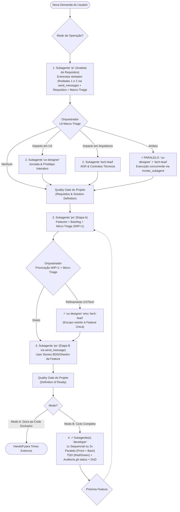

# dev-team 2.0.1: Time Multi-Agente de Engenharia Ágil & Docs-as-Code

Bem-vindo ao **dev-team 2.0.1**, um ecossistema multi-agente de engenharia de software para o **Google Antigravity 2.0** e CLI (`agy`), desenhado em **Arquitetura Híbrida (`skills/` + `agents/`)** com **Fonte Única de Verdade (`Single Source of Truth`)** e subordinado à governança corporativa **Docs-as-Code**.

Diferente de pacotes baseados apenas em skills (que acumulam todas as fases no mesmo contexto da conversa principal), o **dev-team 2.0.1** separa claramente:
- **6 Agentes Especialistas Nativos (`agents/*.md` — "Quem executa")**: Subagentes enxutos com **contexto próprio e isolado**, **tier de modelo configurado na plataforma (`model: flash` com escalação controlada para `pro`)**, **`inheritMcp: false` por padrão**, **ferramentas restritas ao mínimo necessário** e **trava anti-delegação espontânea (`[Só via /dev-team]`)**.
- **9 Skills Modulares (`skills/*/SKILL.md` — "Como fazer")**: Constituem a **Fonte Única de Verdade** dos procedimentos de cada papel (evitando duplicação e divergência de manutenção) e preservam todos os atalhos de barra (`/dev-team`, `/analise-requisitos`, `/prototipacao-ui`, `/decisao-arquitetural`, `/design-api-contratos`, `/refinamento-po`, `/desenvolvimento`, `/diagnostico-bug`, `/redacao-atas`).



---

## 0. Regra Mestre de Override (Inversão de Controle) e Nota de Transparência

O `dev-team` opera com **inteligência subordinada e orientada a capacidades**:

1. **Subordinação Integral ao Manifesto do Projeto (`AGENTS.md` / `AI_GOVERNANCE.md`)**: A primeira ação mandatória do Orquestrador e de qualquer subagente é ler o manifesto de governança na raiz do repositório alvo. As diretrizes locais sobre quais artefatos produzir, templates, estrutura de seções, status de ciclo de vida, stack tecnológica, convenções de versionamento e Quality Gates (DoR/DoD) sobrepõem sumariamente quaisquer definições padrão do time.
2. **Proibição Absoluta de Arquivos Proprietários**: O `dev-team` é terminantemente proibido de criar arquivos de configuração internos (como `.devteamrc` ou `.devteam-config.yml`) no projeto consumidor.
3. **Passagem de Bastão via Docs-as-Code**: Como cada subagente roda em uma janela de contexto limpa e isolada, o handoff entre papéis ocorre através dos artefatos versionados no repositório (PRD, Jornada, Protótipo, ADR, Contratos, Features e User Stories).

> [!IMPORTANT]
> **Nota de Transparência Arquitetural (Configuração da Plataforma vs. Calibragem por Prompt)**
> No Antigravity 2.0, o `dev-team` separa de forma explícita o que é imposto pelo runtime da plataforma do que é governado por instruções de prompt:
> - **Aplicado pela Plataforma (Frontmatter YAML dos Agentes & Runtime)**:
>   - **Isolamento de Contexto**: Cada subagente (`invoke_subagent`) inicia com janela de contexto limpa e própria.
>   - **Tier de Modelo (`model: flash` / `Model: "pro"`)**: Aplicado nativamente pelo runtime do subagente e sobrescritível pelo Orquestrador via `invoke_subagent(..., Model: "pro")`.
>   - **Escopo de Ferramentas (`tools`), `inheritMcp: false` e `commandExecutionPolicy: sandbox`**: Aplicados pelo motor Cortex na inicialização do subagente.
> - **Aplicado por Calibragem Comportamental de Prompt e Auditoria do Orquestrador**:
>   - **Esforço de Raciocínio (*Low / Medium / High-Effort*)**: A plataforma Antigravity 2.0 não possui campo YAML de `thinking_effort` individual por subagente (o *thinking budget* da API é herdado da sessão pai). A diferenciação de esforço entre os papéis é realizada por calibragem comportamental no prompt de cada agente (respostas diretas no AR/Redator vs. checklists analíticos e ciclo TDD físico no Tech Lead/Developer).
>   - **Propriedade Exclusiva de Arquivos (*Exclusive File Ownership*) e Disjuntor de 2 Falhas**: São regras de prompt auditadas pelo Orquestrador ao final de cada turno (via `git status --short` e verificação do output literal de testes).

---

## 1. Os 6 Agentes Especialistas (`agents/*.md`)

Todos os 6 agentes possuem `mainAgent: false`, `subagent: true`, `inheritMcp: false` (para economizar tokens de schemas MCP; se um projeto exigir MCP no `tech-lead` ou `developer`, basta habilitar ou informar ao Orquestrador) e prefixo `[Só via /dev-team]` na descrição para evitar delegação espontânea fora da esteira:

| Agente (`agents/`) | Fonte Única de Procedimento (`skills/`) | Tier Nativo (`model`) | Ferramentas Habilitadas (`tools`) | Calibragem Comportamental & Escalação (`pro`) |
| :--- | :--- | :--- | :--- | :--- |
| **`ar`** (`agents/ar.md`) | `skills/analise-requisitos/SKILL.md` | `flash` | `send_message`, `view_file`, `write_file`, `edit_file`, `read_url_content`, `search_web`, `run_command` | **Low-Effort / Direto**: Elicitação em 2 rodadas (repassadas *verbatim* pelo Orquestrador e respondidas via `send_message`) + Macro-Triage. Escala para `pro` sob aprovação humana em domínios regulatórios/matemáticos densos. |
| **`ux-designer`** (`agents/ux-designer.md`) | `skills/prototipacao-ui/SKILL.md` | `flash` | `send_message`, `view_file`, `write_file`, `edit_file`, `generate_image`, `read_url_content`, `search_web`, `run_command` | **Medium-Effort / 4 Estados**: Jornada do Usuário + Protótipos funcionais cobrindo os estados Vazio, Loading, Erro e Sucesso. Escala para `pro` em interfaces com múltiplos estados concorrentes. |
| **`tech-lead`** (`agents/tech-lead.md`) | `skills/decisao-arquitetural/SKILL.md`<br/>`skills/design-api-contratos/SKILL.md` | `flash` | `send_message`, `view_file`, `write_file`, `edit_file`, `run_command`, `read_url_content`, `search_web` | **High-Effort / Matriz de Trade-offs**: ADRs comparando alternativas e Contratos Técnicos (OpenAPI, GraphQL, DDL SQL). Escala para `pro` sob aprovação humana em sistemas distribuídos críticos/concorrência severa. |
| **`po`** (`agents/po.md`) | `skills/refinamento-po/SKILL.md` | `flash` | `send_message`, `view_file`, `write_file`, `edit_file`, `run_command` | **Medium-Effort / Cadência com STOPS**: Etapa A (Features + Backlog + Micro-Triage) $\rightarrow$ STOP $\rightarrow$ Etapa B via `send_message` (User Stories BDD/Gherkin atômicas `WIP=1`). |
| **`developer`** (`agents/developer.md`) | `skills/desenvolvimento/SKILL.md`<br/>`skills/diagnostico-bug/SKILL.md` | `flash` | `send_message`, `view_file`, `write_file`, `edit_file`, `run_command`, `manage_task`, `read_url_content`, `search_web` | **High-Effort / TDD Red-Green + DoD**: Implementação, testes automatizados e diagnóstico de bugs. Suporta paralelismo (Front + Back) com proteção de lockfiles. Disjuntor de escalação para `pro` após 2 rodadas de falha de testes no Flash. |
| **`redator-atas`** (`agents/redator-atas.md`) | `skills/redacao-atas/SKILL.md` | `flash` | `send_message`, `view_file`, `write_file`, `edit_file`, `run_command` | **Low-Effort / Fidelidade Determinística**: Converte registros brutos de reunião em atas fiéis ao que foi dito, seguindo 100% o template e validador do projeto. |

---

## 2. Paralelismo Real, Proteção de Lockfiles e Continuidade Multi-Turno

1. **Paralelismo na Solution Definition (`ux-designer` + `tech-lead`)**:
   Quando a Triagem indicar impacto simultâneo em UX e Arquitetura, o Orquestrador dispara ambos os subagentes **no mesmo turno** via `invoke_subagent`.
2. **Paralelismo na Implementação (`Developer Frontend` + `Developer Backend`) + Auditoria `git status`**:
   - No Modo B (Ciclo Completo), quando uma Feature possui contrato técnico e protótipo aprovados e fronteiras desacopladas, o Orquestrador instancia até **2 subagentes `developer` simultâneos** em `Workspace: "inherit"`.
   - **Proteção de Lockfiles e Manifestos Raiz**: Qualquer instalação de pacotes em arquivos compartilhados (`package.json`, lockfiles, `pyproject.toml`, etc.) é feita em passo sequencial prévio; é proibido aos Developers paralelos editar manifestos raiz compartilhados.
   - **Auditoria Determinística**: Ao término da execução paralela, o Orquestrador executa `git status --short` para auditar que cada Developer modificou apenas seus diretórios exclusivos.
3. **Continuidade Multi-Turno por Subagente (`send_message`)**:
   Nas etapas interativas ou em duas fases (Rodadas 1 e 2 do `ar`, Etapas A e B do `po`), o Orquestrador repassa perguntas ao usuário **ao pé da letra (verbatim)** e reutiliza o mesmo `ConversationId` do subagente via `send_message`, preservando a memória local do especialista.

---

## 3. Como Usar no Google Antigravity

* **Iniciar Esteira Completa com o Orquestrador**:
  > `/dev-team Vamos iniciar a funcionalidade de autenticação social.`

* **Ou acionar habilidades específicas diretamente**:
  * **Análise de Requisitos**: `/analise-requisitos Conduza a entrevista investigativa para o recurso X.`
  * **Prototipação UI**: `/prototipacao-ui Crie a jornada UJ e o protótipo da tela de checkout.`
  * **Decisão Arquitetural**: `/decisao-arquitetural Avalie a migração de cache com uma ADR comparando Redis e Memcached.`
  * **Design de APIs & Contratos**: `/design-api-contratos Modele o contrato OpenAPI dos endpoints de pagamento.`
  * **Refinamento PO**: `/refinamento-po Decomponha a Feature X em User Stories BDD.`
  * **Desenvolvimento**: `/desenvolvimento Implemente a US-001 com cobertura total de testes em TDD.`
  * **Diagnóstico de Bug**: `/diagnostico-bug Diagnostique o erro 500 no endpoint de pagamentos.`
  * **Redação de Atas**: `/redacao-atas Gere a ata a partir do registro da reunião indicado.`

---

## 4. Estrutura Canônica do Plugin (`dev-team 2.0.1`)

```text
dev-team/
├── agents/                                   # "Quem executa": Subagentes enxutos com contexto isolado, tier flash e ferramentas restritas
│   ├── ar.md                                 # Analista de Requisitos (skills: ../skills/analise-requisitos)
│   ├── ux-designer.md                        # UX / Product Designer (skills: ../skills/prototipacao-ui)
│   ├── tech-lead.md                          # Tech Lead / Architect (skills: ../skills/decisao-arquitetural, ../skills/design-api-contratos)
│   ├── po.md                                 # Product Owner (skills: ../skills/refinamento-po)
│   ├── developer.md                          # Developer TDD & Bug Diagnosis (skills: ../skills/desenvolvimento, ../skills/diagnostico-bug)
│   └── redator-atas.md                       # Redator de Atas sob demanda (skills: ../skills/redacao-atas)
├── skills/                                   # "Como fazer" (Fonte Única de Verdade): Procedimentos detalhados e slash commands
│   ├── dev-team/                             # Habilidade Mestre e Orquestrador (Delegação, Gates, FinOps e Auditoria de Paralelismo)
│   ├── analise-requisitos/                   # Procedimento de Engenharia de Requisitos e Macro-Triage
│   ├── prototipacao-ui/                      # Procedimento de Jornada do Usuário e Protótipos Interativos (4 estados)
│   ├── decisao-arquitetural/                 # Procedimento de ADRs e Matriz de Trade-offs
│   ├── design-api-contratos/                 # Procedimento de Contratos de API e Schemas de Dados
│   ├── refinamento-po/                       # Procedimento de Features, Backlog e User Stories BDD/Gherkin (WIP=1)
│   ├── desenvolvimento/                      # Procedimento de TDD Red/Green, Proteção de Lockfiles, Circuit Breaker e DoD
│   ├── diagnostico-bug/                      # Procedimento de diagnóstico estruturado e regressão TDD de bugs
│   └── redacao-atas/                         # Procedimento do Redator de Atas (opcional, sob demanda)
├── plugin.json                               # Manifesto oficial do plugin Antigravity 2.0 (v2.0.1)
└── README.md                                 # Documentação arquitetural e nota de transparência
```
