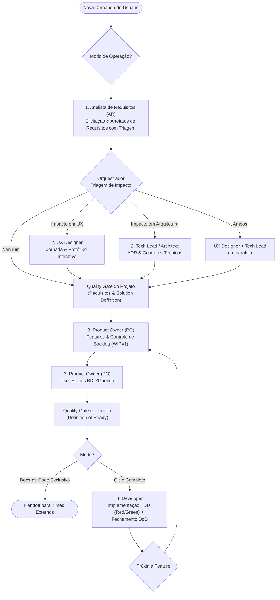

# dev-team: Time Multi-Agente de Engenharia Ágil & Docs-as-Code

Bem-vindo ao **dev-team**, um ecossistema multi-agente de desenvolvimento de software de alta performance para o Google Antigravity e VS Code, orientado à governança corporativa **Docs-as-Code**.

O dev-team estrutura cinco especialidades independentes que operam em pipeline contínuo e colaborativo, cobrindo todo o ciclo de vida do software: **Analista de Requisitos (AR)**, **UX / Product Designer**, **Tech Lead / Architect**, **Product Owner (PO)** e **Developer**, além do papel opcional e sob demanda **Redator de Atas**, que transforma registros brutos de reunião em atas padronizadas conforme o template e o validador designados pelo manifesto do projeto.



---

## 0. Regra Mestre de Override (Inversão de Controle)

O dev-team opera com **inteligência subordinada e orientada a capacidades**:

1. **Subordinação Integral ao Manifesto do Projeto (`AGENTS.md` / `AI_GOVERNANCE.md`)**: A primeira ação mandatória de qualquer agente é ler o manifesto de governança na raiz do repositório alvo. As diretrizes locais sobre quais artefatos produzir, templates, estrutura de seções, status de ciclo de vida, stack tecnológica, convenções de versionamento e Quality Gates (DoR/DoD) sobrepõem sumariamente quaisquer definições padrão do time.
2. **Proibição Absoluta de Arquivos Proprietários**: O dev-team é terminantemente proibido de criar arquivos de configuração internos (como `.devteamrc` ou `.devteam-config.yml`) no projeto consumidor. O projeto alvo permanece 100% limpo de metadados da equipe.
3. **Respeito aos Padrões Locais do Repositório**: Os padrões de engenharia, templates e validadores residem no próprio projeto consumidor, sendo lidos e respeitados dinamicamente a cada atuação.

---

## 1. As Especialidades da Equipe

O dev-team fornece os papéis e comportamentos especializados, enquanto **os artefatos exigidos, seus templates, formatos, status e diretórios são 100% governados pelo manifesto `AGENTS.md` do projeto consumidor** (Inversão de Controle).

Abaixo estão as responsabilidades de cada papel:

### 1.1. Analista de Requisitos (AR)
* **Atribuição**: Elicitação profunda através de questionamento investigativo exaustivo, delimitação de escopo, regras de negócio, produção de toda a cadeia de artefatos de requisitos mapeada pelo projeto e preenchimento da Triagem de Impacto.
* **Modelo LLM**: Tier nativo `flash` (Gemini 3.8 Flash). **Esforço de Raciocínio**: `low` (altíssima velocidade, ampla janela de contexto e consumo mínimo de tokens de reflexão).
* **Artefatos**: Todos os documentos de descoberta, levantamento e especificação funcional (ex: PRD) atribuídos ao papel no `AGENTS.md` local.

### 1.2. UX / Product Designer
* **Atribuição**: Mapeamento de fluxos de interação, jornadas do usuário, estados de interface, microinterações e construção de protótipos funcionais interativos alinhados ao Design System do projeto.
* **Modelo LLM**: Tier nativo `flash` (Gemini 3.8 Flash). **Esforço de Raciocínio**: `medium`. Escalação para `pro` (Gemini 4 Argon) sob recomendação e autorização humana para interfaces com múltiplos estados concorrentes complexos.
* **Artefatos**: Documentação de Jornada do Usuário e protótipos interativos na estrutura e stack designadas pelo projeto consumidor.

### 1.3. Tech Lead / Architect
* **Atribuição**: Avaliação de viabilidade técnica, modelagem de dados, especificações formais de contratos/APIs e registro formal de decisões e trade-offs arquiteturais.
* **Modelo LLM**: Tier nativo `flash` (Gemini 3.8 Flash). **Esforço de Raciocínio**: `high` (reflexão aprofundada para evitar débitos técnicos). Escalação para `pro` (Gemini 4 Argon) sob recomendação e autorização humana para arquiteturas distribuídas de missão crítica e concorrência severa.
* **Artefatos**: Decisões Arquiteturais (ADR) e contratos/schemas técnicos conforme o manifesto local.

### 1.4. Product Owner (PO)
* **Atribuição**: Decomposição em Features de negócio, manutenção das matrizes/índices de controle de Backlog do projeto e desdobramento em Histórias de Usuário atômicas (WIP=1) com critérios de aceite em BDD/Gherkin, contratos e restrições.
* **Modelo LLM**: Tier nativo `flash` (Gemini 3.8 Flash). **Esforço de Raciocínio**: `medium` (precisão estruturada e formatação consistente sem queima de cota).
* **Artefatos**: Definições de Feature, controle de Backlog e Histórias de Usuário seguindo os templates do projeto.

### 1.5. Developer
* **Atribuição**: Implementação do código de produção na stack nativa do projeto e testes automatizados com ciclo TDD rigoroso (Red/Green), respeitando as histórias, protótipos e contratos aprovados, além do cumprimento integral da *Definition of Done* (DoD) local. Suporta paralelismo (ex: Frontend e Backend simultâneos).
* **Modelo LLM**: Tier nativo `flash` (Gemini 3.8 Flash). **Esforço de Raciocínio**: `high` (simulação mental de testes e cobertura completa). Escalação para `pro` (Gemini 4 Argon) sob recomendação e autorização humana para refatoração de código com acoplamento massivo ou após 2 tentativas de falha de teste no Flash.
* **Trilha de Diagnóstico de Bugs**: Diagnóstico estruturado de causa raiz e roteiro TDD de regressão conforme o fluxo de defeitos definido no projeto.

### 1.6. Redator de Atas (opcional, sob demanda)
* **Atribuição**: Transformar registros brutos de reunião (transcrição, notas, VTT, texto) em atas padronizadas para consumo por agentes e pessoas. Fora da esteira sequencial; acionado quando o usuário trouxer um registro de reunião ou pedir uma ata. Funciona nos dois modos de operação, pois só produz documentação.
* **Agnóstico**: Formato, template, destino, nomenclatura, status inicial, schema e validador vêm exclusivamente do manifesto do projeto. Se o projeto não definir o padrão, o papel para e avisa. Nunca inventa decisões, nunca aprova e gera sempre no status inicial.
* **Modelo LLM**: Tier nativo `flash` (Gemini 3.8 Flash). **Esforço de Raciocínio**: `low`; temperatura 0.2 (fidelidade).

---

## 2. Modos de Operação do Time

O dev-team adapta sua atuação conforme o escopo acordado no projeto:

* **Modo A: Docs-as-Code Exclusivo**: Atuação estritamente analítica e arquitetural (Requisitos, UX, Arquitetura e Histórias de Usuário). O time **não cria nem edita código de produção**, entregando especificações blindadas para times ou desenvolvedores externos.
* **Modo B: Ciclo Completo (End-to-End)**: Concepção completa via Docs-as-Code seguida de implementação em código de produção e testes unitários/integração verdes pelo Developer.

---

## 3. Como Usar no Google Antigravity

Você pode interagir diretamente com o dev-team no chat do Antigravity usando a skill mestre na primeira mensagem da conversa:

* **Iniciar Esteira do dev-team**:
  > `/dev-team Vamos iniciar a funcionalidade de autenticação social.`

* **Ou invocar habilidades específicas diretamente**:
  * **Análise de Requisitos**: `/analise-requisitos Conduza a entrevista investigativa para o recurso X.`
  * **Prototipação UI**: `/prototipacao-ui Crie a jornada UJ e o protótipo da tela de checkout.`
  * **Decisão Arquitetural**: `/decisao-arquitetural Avalie a migração de cache com uma ADR comparando Redis e Memcached.`
  * **Design de APIs & Contratos**: `/design-api-contratos Modele o contrato OpenAPI dos endpoints de pagamento.`
  * **Refinamento PO**: `/refinamento-po Decomponha a Feature X em User Stories BDD.`
  * **Desenvolvimento**: `/desenvolvimento Implemente a US-001 com cobertura total de testes em TDD.`
  * **Diagnóstico de Bug**: `/diagnostico-bug Diagnostique o erro 500 no endpoint de pagamentos.`
  * **Redação de Atas**: `/redacao-atas Gere a ata a partir do registro da reunião indicado.`

---

## 4. Estrutura de Diretórios do dev-team

Estrutura canônica do plugin:

```text
dev-team/
├── config/
│   └── model_router.json                     # Matriz Flash-First, esforço de raciocínio (thinking effort) e gate de cota
├── skills/
│   ├── dev-team/                             # Habilidade Mestre e Orquestrador (Opt-in)
│   ├── analise-requisitos/                   # Habilidade do AR (Engenharia de Requisitos e Triagem de Impacto)
│   ├── prototipacao-ui/                      # Habilidade do UX Designer (Jornada do Usuário e Protótipos Interativos)
│   ├── decisao-arquitetural/                 # Habilidade do Tech Lead (ADRs e Trade-offs)
│   ├── design-api-contratos/                 # Habilidade do Tech Lead (Contratos de API e Schemas de Dados)
│   ├── refinamento-po/                       # Habilidade do PO (Features, Backlog e Histórias com BDD/Gherkin)
│   ├── desenvolvimento/                      # Habilidade do Developer (TDD Red/Green, Paralelismo e Fechamento DoD)
│   ├── diagnostico-bug/                      # Habilidade de diagnóstico estruturado e regressão TDD de bugs
│   └── redacao-atas/                         # Habilidade do Redator de Atas (opcional, sob demanda)
├── plugin.json                               # Manifesto do plugin Antigravity
└── README.md                                 # Este manual
```
